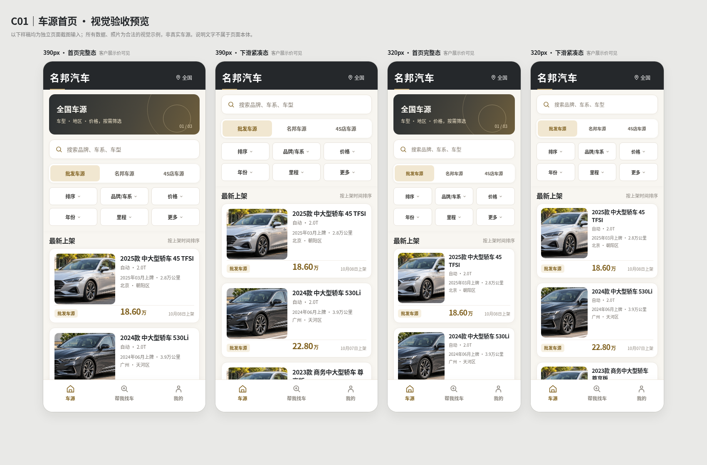

# 名邦汽车 V1｜H01 最终视觉评审入口（当前唯一视觉整改稿）

> 2026-10-08；状态：**READY_FOR_A_REVIEW / VISUAL_QA_PASS / A_REVIEW_PENDING**。
> A 主控已认定旧照片版仅结构、规范基本通过，**视觉未通过**。本文件现已指向**重新打磨后的最终视觉整改稿**，不是 H01 ACCEPTED。

## 请先看这张实测预览

四个**没有开发备注叠在页面本体上**的独立截图：

| 390px | 320px |
| --- | --- |
| [390px 完整态](最终视觉验收/C01/rendered/C01_390_full.png) | [320px 完整态](最终视觉验收/C01/rendered/C01_320_full.png) |
| [390px 紧凑态](最终视觉验收/C01/rendered/C01_390_compact.png) | [320px 紧凑态](最终视觉验收/C01/rendered/C01_320_compact.png) |

另见 [普通 LIMITED 批发列表无数字价的实际截图](最终视觉验收/C01/rendered/C01_390_full_LIMITED.png)。

## 直接交 A 主控复审的材料

1. **[最新 H01 C01 视觉整改完整说明](最终视觉验收/C01/H01_C01_最终视觉验收说明.md)** —— 本轮新增/修改的 13 个真实 GitHub 文件、结构对照、照片来源、自动化检查与未闭环清单。
2. **[离线 HTML 设计源](最终视觉验收/C01/index.html)** —— HTML 与同层 `assets/` 两张照片一起下载后可离线打开，所有画板可直接审查；没有依赖远端服务。
3. **[精确布局检查 JSON](最终视觉验收/C01/C01_布局检查.json)** —— 四张 PNG SHA256、每状态 DOM 尺寸与图片真实解码像素。
4. **[Playwright/Chromium 复测脚本](最终视觉验收/C01/复现浏览器验收.py)** —— 可重复产出 320/390 画板截图与权益负例。
5. **[两张原始高清照片](最终视觉验收/C01/assets/car_sample_1.jpg)**、[第二张](最终视觉验收/C01/assets/car_sample_2.jpg) —— 两辆不同轿车，分别 1536×517 / 1536×484，来自本轮合法 AI 示例双场景的独立裁图，不是库存/检测实拍。
6. 主业务权威保持：PDM-01～25 Final、Current IA、Current Low-Fi；视觉色彩沿用用户确认的暖白、石墨、克制金色，**具体 HEX 尚未永久冻结**。

## 历史版本警示

此前 `样稿/H01_最终视觉验收_照片版320_390.svg` 曾只复用一张小图片；此前 `07_重建工作区/设计执行回报/H01_最终视觉收口与真实渲染证据.md` 提到 PNG/HTML 只在聊天附件，均是**旧轮次记录，已被本次实际 GitHub 照片＋PNG＋HTML 文件替代**，不得作为当前审查资产。

**待办**：A 主控对本次页面观感/商业质感独立复审、用户最终确认、正式 Logo/品牌授权/小程序真机条件检查。C 不能自行宣布 H01 `ACCEPTED`，本轮未启动 H02/H03，未修改 main、PDM、IA、Low-Fi 或工程代码。
