# 名邦汽车 V1｜H01 最终视觉评审入口（待 A 验收）

> 日期：2026-10-08；分支：`design/h01-design-system`。
> 状态：`READY_FOR_A_REVIEW`；**不得将本材料理解为 H01 ACCEPTED 或 H02/H03 开工放行**。
> A 主控已完成 H01 定向返修结构与规范复审；本文件只补最后一轮**汽车照片、320/390px 排版与实际浏览器证据**。

## 直接查看完整视觉效果

> GitHub 如限制 SVG 中的内嵌照片，请下载本 SVG 在浏览器打开；它是独立的、无外部 URL 图片依赖的静态评审资产。
> 浏览器真实 320/390px HTML 渲染及 PNG 对照由 C 在本轮会话提供，具体证据索引见 `07_重建工作区/设计执行回报/H01_最终视觉收口与真实渲染证据.md`。

## 本轮评审请看这六点

1. 暖白、石墨与克制金色的整体质感，具体 HEX 依然可调整；
2. C01 完整态的 HOME_TOP 小 Banner 与实际车源信息占比；
3. 下滑紧凑态没有 Banner，但品牌、搜索、来源频道、六项主筛选仍持续可见；
4. 320px 与 390px 的车型标题、地区/里程、图片裁切、价格状态是否顺畅；
5. 普通 LIMITED 批发列表不显示数字客户价，UNLIMITED 有真实合法数字价时可显示紧凑数字价；所有样例数字不是车源事实；
6. 底部严格 `车源｜帮我找车｜我的`，不新增收藏四栏、认证标签或营销话术。

## 图片与版式事实说明

- 汽车照片由本轮生成式图片工具创建，为**合法设计示例素材**，并非平台真实二手车照片，也不代表具体车型、车况认证、库存或交易。
- GitHub 当前 SVG 内嵌了**通过图片解码校验的单张无品牌轿车示例图**，以免外部图片失效；会话附件的离线 HTML/浏览器 PNG 还对照使用了两张不同轿车示例照片做裁切试验。两者**不是完全相同的图片组合**，但均遵守同一 C01 结构原则。
- 车型/上牌时间/里程/城市/价格均属排版示意；**不把任何展示例子当成数据库中真实车辆**。
- 本次只是最终视觉验收输入，不实现真实滚动阈值、运营 Banner 配置、权限后端或动态列表。

## 追溯与复审

- 已确认视觉方向：`H01视觉方向确认与修订交接单.md`。
- 规则输入：`06_设计输入清单与A返修闭环.md`。
- Design Token：`设计令牌_候选.json` 与 `设计令牌_语义.css`。
- 前一轮三端代表视觉：`样稿/H01-4_C客户代表模板.svg`、`样稿/H01-4_E员工代表模板.svg`、`样稿/H01-4_P后台代表模板.svg`。
- 浏览器 QA：`07_重建工作区/设计执行回报/H01_最终视觉收口与真实渲染证据.md`。
- 未闭环 A 主控视觉意见、授权 Logo、有无商业品牌手册、真实小程序设备验证；H02 未开始。
