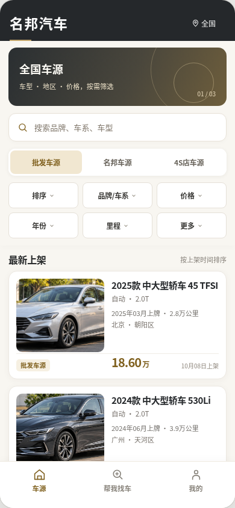
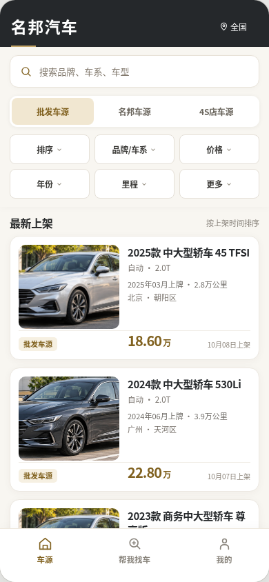
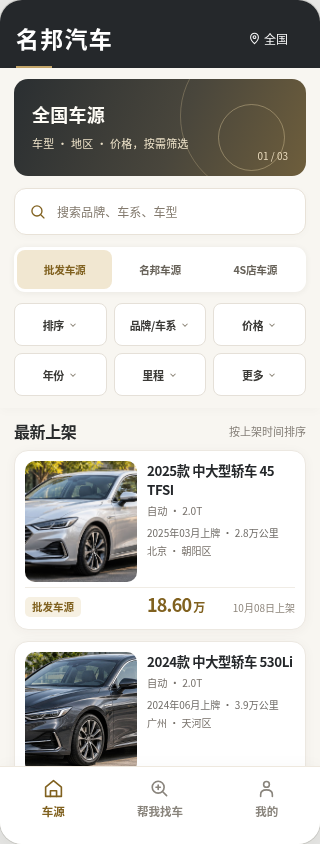
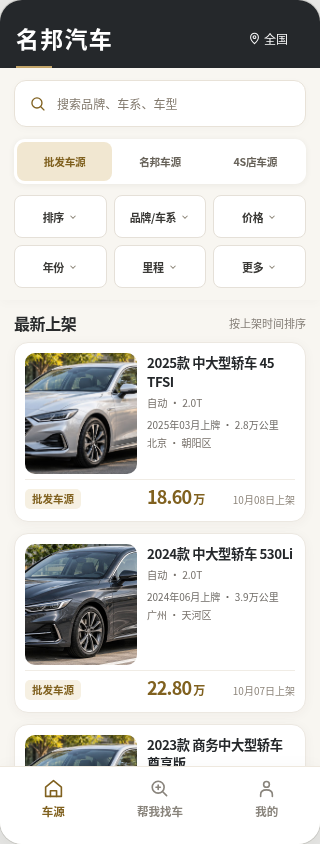

# 名邦汽车 V1｜H01 C01 最终视觉质量整改｜交 A 主控复审

> 2026-10-08；本次仅设计验收材料，分支 `design/h01-design-system`。
> **状态：`READY_FOR_A_REVIEW / VISUAL_REVISION_SUBMITTED`，不是 H01 `ACCEPTED`。**
> A 主控上一轮已确认结构与规范基本通过，但视觉不通过。本轮只按新交接整改视觉，不改 PDM Final、Current IA、Current Low-Fi、main 或工程代码；**不启动 H02/H03**。

## 1. 直接审查成品

四张 PNG 是从 Chromium 实际页面容器截取的**纯客户端页面**，没有在页面本体上叠加设计注释。

| 页面 | 实际浏览器 PNG | 评审内容 |
| --- | --- | --- |
| C01 / 390px 完整态 |  | 有 `HOME_TOP` Banner、搜索、三来源、六筛选、Feed、底部三导航 |
| C01 / 390px 下滑紧凑态 |  | 移除 Banner，保留固定信息与连续看车 |
| C01 / 320px 完整态 |  | 小屏保留同一业务结构，标题/字段有安全裁剪 |
| C01 / 320px 下滑紧凑态 |  | 小屏紧凑浏览，无横向溢出 |

[一次查看四态画廊](rendered/C01_四态画廊.png)  
[普通客户 LIMITED 批发列表不显示数字价格的补充截图](rendered/C01_390_full_LIMITED.png)

## 2. 源文件与本次视觉变化

- **可离线打开的完整设计稿**：[`index.html`](index.html)。与 `assets/car_sample_1.jpg` / `assets/car_sample_2.jpg` 保持同目录树，即可使用普通浏览器 `file://` 打开（无需联网/安装服务/请求生产接口）。HTML 内的最上层外框是审查画廊，不是小程序页。
- **实际图片资产**：两张**不同车辆**的无品牌 AI 生成合法示例照片，分别 `1536×517px` 与 `1536×484px`，作为**两份独立 JPEG 二进制文件**保存在仓库，不再放大旧 `178×104` 等缩略图。上游素材由同一张 AI 生成的双场景图裁切为两个互不相同的轿车画面。照片不是名邦真实车源，不代表商标、车型、保养/检测/认证事实。
- **中文界面信息密度**：加大核心车型标题字重，保持卡片内两行可截断标题、上牌/里程/地区与当前上架时间的层级；紧凑的右侧价格归于信息区，不恢复独立价格宽列。
- **品牌视觉**：`暖白背景 + 石墨主色 + 克制金色`，沿用 H01 Design Token 的当前候选；未将金色与警告/错误/成功混为一类，**HEX 未冻结**。
- **首页结构不变**：默认全国 / 批发车源，来源三项：批发、名邦、4S；六个主筛选：排序、品牌/车系、价格、年份、里程、更多；底部三项：车源、帮我找车、我的。无额外四栏收藏，无无事实营销或认证标签。
- **完整与紧凑差异**：完整态展示占高适度的 HOME_TOP Banner；紧凑态去 Banner，但搜索、来源、六筛选与品牌标题均保持，第三套半折叠态没有出现；实际滚动阈值不在 H01 实现。
- **价格投影**：四张主稿示例为已有合法客户展示价格权益的粉丝/VIP 情况，数字价格仅为假数据；另有 `rendered/C01_390_full_LIMITED.png` 显示普通客户在批发 Feed 上**不展示数字价**，未恢复点击查价按钮。

## 3. 可复现浏览器证据

- 输入：`index.html` 和两张原始 JPEG。
- 工具：Python `Playwright` + `Chromium` + `Pillow`；复测脚本 [`复现浏览器验收.py`](复现浏览器验收.py)。
- 本环境 Chrome 对 `file://` 自动化访问有限制，复测脚本仅将 HTML 的两条本地照片路径替换为**原图 data URI**，再通过 `page.set_content` 渲染；**CSS/文字/布局/图像字节均与脱机源一致**。
- 真实渲染四态（`390×844` 完整/紧凑、`320×844` 完整/紧凑） **4/4 通过**：浏览器 DOM 实测 `scrollWidth == clientWidth`、三频道、六筛选、三导航、Banner 仅完整态出现，三张卡片图片成功解码且 `naturalWidth=1536`。
- 单独 LIMITED 负例：所有卡片的数字价格显示规则为 `display:none`，已截取 `C01_390_full_LIMITED.png`；这只是静态设计投影检查，**不证明服务端权限实现**。
- 具体宽高/字体/截图 SHA256、每张图片原始分辨率与哈希见 [`C01_布局检查.json`](C01_布局检查.json)；图片源说明见 [`图片来源与画板索引.json`](图片来源与画板索引.json)。
- 除真实浏览器视图外，**未**进行原生微信小程序、实机 Android/iOS、语音阅读/无障碍完整审计、真实 Banner/车辆 API /权限端到端验证。

## 4. 本轮实际新增路径

本次新建 `10_设计执行/H01/最终视觉验收/C01/` 下：
- `index.html`
- `assets/car_sample_1.jpg`、`assets/car_sample_2.jpg`
- `rendered/C01_390_full.png`、`C01_390_compact.png`、`C01_320_full.png`、`C01_320_compact.png`
- `rendered/C01_390_full_LIMITED.png`、`rendered/C01_四态画廊.png`
- `C01_布局检查.json`、`图片来源与画板索引.json`、`复现浏览器验收.py`
- 本审查说明。

所有照片、PNG 和 HTML 源**已作为 GitHub C 分支原始文件入库**，不再仅留聊天附件；A 可在浏览器直接看 GitHub 上的截图并核对复现证据。

## 5. 尚未闭环与后续

1. **A 主控独立视觉复审**：当前不通过/通过必须由 A 作最终复审，C 不可自签 `ACCEPTED`。
2. **用户最终视觉观感确认**：图片比例、文字密度、信息层级是否符合品牌定位。
3. **正式 Logo 资产和具体 HEX**：尚未收到经核实的官方 Logo/品牌色，当前文字字标及金色仅为候选，不当作已获授权品牌手册。
4. **真实小程序实机、安全区、滚动实现、复杂状态和生产数据**：需后续独立 H02/H03 门禁与工程阶段处理，本轮仅完成 H01 静态视觉证据。
5. **真实性隔离**：车型/地区/上牌/里程/价格均为视觉样例，不可当成供应真实事实；任何对外发布前应替换真实 Customer Safe 数据并合法控权。

**最终状态：`H01_C01_VISUAL_QA_READY_FOR_A / A_REVIEW_PENDING`，不进入 H02/H03，不合并 main。**
